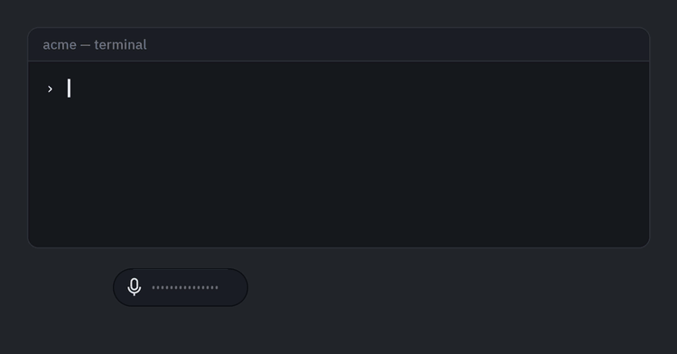

<p align="center">
  
</p>

<h1 align="center">Flow</h1>

<p align="center">
  Local English dictation with a talk-to-it refine loop
</p>

<p align="center">
  <a href="https://github.com/samartomar/flow/releases/latest"></a>
  
  <a href="#macos-and-linux"></a>
  <a href="https://github.com/samartomar/flow/actions/workflows/ci.yml"></a>
  <a href="LICENSE"></a>
</p>

<p align="center">
  <a href="https://github.com/samartomar/flow/releases/latest/download/Flow-Setup.exe"><strong>Download Flow for Windows</strong></a> ·
  <a href="#install">Setup help</a> ·
  <a href="docs/guide.md">Guide</a> ·
  <a href="https://github.com/samartomar/flow/issues/new">Report a mishearing</a>
</p>



Hold <kbd>Ctrl</kbd>+<kbd>Win</kbd>, say what you want to write, and let go. Flow pastes the
words wherever you were typing: your editor, a terminal, Slack, a browser tab. If it heard
something wrong, hold the keys again and say *"change Tuesday to Thursday"* or *"scratch
that"*, and it fixes the text it just pasted.

To rewrite what you just pasted, hold again and say *"polish that"* or *"make it shorter"*.
Flow uses your agent CLI and your selected writing style. To ask a question, hold
<kbd>Ctrl</kbd>+<kbd>Alt</kbd>+<kbd>Win</kbd>. The answer appears on a card above the pill.

I made Flow for people whose English has an accent that speech recognition keeps tripping
over, often enough that they give up and type. Spanish, Indian, Russian and Japanese
speakers are who it's designed and benchmarked for. Recognition runs on your own machine,
there's no account or API key, and your audio never leaves your PC.

## Install

### Windows

You need Windows 10 or 11 and a microphone.

[Download **Flow-Setup.exe**](https://github.com/samartomar/flow/releases/latest/download/Flow-Setup.exe).
Double-click it, choose **Install**, and leave **Open Flow** checked when you finish.
After setup, open **Flow** from the Windows Start menu. Flow Home walks you through
your first dictation.
Opening Flow again brings up the running copy's Flow Home.

For the portable version, or for a release that only has a zip:

1. [Download the Windows zip](https://github.com/samartomar/flow/releases/latest/download/flow-windows-x64.zip).
2. In Downloads, right-click `flow-windows-x64.zip` and choose **Extract All**.
3. Open the extracted **flow** folder and double-click **flow.exe**. Flow Home opens
   on first launch and guides you through your microphone and speech models.

For later launches, double-click the same `flow.exe`. You can start Flow entirely
from File Explorer.

> [!NOTE]
> Windows downloads are unsigned, so the first launch can show a SmartScreen warning. Click
> **More info**, then **Run anyway**.

If you already use [Scoop](https://scoop.sh), install the same build and then search
for **Flow** in the Windows Start menu.

```powershell
scoop bucket add flow https://github.com/samartomar/scoop-flow
scoop install flow/flow    # flow/ matters: Scoop's main bucket has a different "flow"
```

#### Command-line install with uv

If you already use [uv](https://docs.astral.sh/uv/), install the Python version and
start it with `flow`.

```bash
uv tool install git+https://github.com/samartomar/flow
flow
```

After a tool install, run `flow` from any directory. Use `uv run flow` inside a
Flow source checkout. The Windows zip and Scoop build include Piper for offline
voices and edge-tts for Natural voices. With the Python install, add those engines
with the `voice` and `edge` extras. See [the guide](docs/guide.md#with-uv--nothing-to-clone)
for the install command and CUDA setup.

The speech models aren't part of any of these. Flow downloads them on first run and shows
you the progress.

### macOS and Linux

Flow Lite, the version for macOS and Linux, is still in progress. Install it with uv, as
above. It has the same recognition, corrections and agent features, but it can't paste into
other apps or listen for global hotkeys. You hold the pill to talk, and Send copies the
text for you to paste. The microphone is the only permission it needs. There's no Mac or
Linux download yet. [More about Lite](docs/product.md#flow-lite--the-portable-body).

### The agent CLI (optional)

Refine and Ask need `codex` or `claude` on your PATH, already signed in. Dictation and
spoken corrections work without either. [The guide](docs/guide.md#install) has the details.

## Using it

1. Hold <kbd>Ctrl</kbd>+<kbd>Win</kbd> (or hold the pill) and talk. The line under the
   pill says it is listening and shows your words as it hears them.
2. Let go, and the text is pasted where your cursor was.
3. Heard you wrong? Hold again and say *"change Tuesday to Thursday"* or *"scratch that"*.
   Flow can fix its last paste until you type or click there. If a hold produces no words,
   click **Check microphone** on the pill’s message. Flow Home shows whether audio arrived
   during that hold. Choose a microphone and click **Test microphone** to watch its level.
4. To rewrite the last paste in your selected style, say *"polish that"* or press
   <kbd>Alt</kbd>+<kbd>Shift</kbd>+<kbd>X</kbd>. To shorten it, say *"make it shorter"*.
5. Pasted into the wrong window? Click the right one and press
   <kbd>Alt</kbd>+<kbd>Shift</kbd>+<kbd>Z</kbd>.
6. For hands-free dictation, tap <kbd>Ctrl</kbd>+<kbd>Win</kbd> once. Speak and pause
   to paste each phrase. Tap again to stop.

The first run walks you through the microphone, the model download, a 45-second tuning to
your voice, and whether to keep a history. You can skip any step.

## Type, Refine, Ask

The pill has three modes, and its colour tells you which one it's in. It starts in Type,
and most of the time that is where it stays, because a rewrite can be asked for after the
words are in. Change mode from the pill's right-click menu or with
<kbd>Ctrl</kbd>+<kbd>Alt</kbd>+<kbd>M</kbd>.

| Mode | Pill | When you let go |
|:---|:---|:---|
| Type | white | The words are pasted. |
| Refine | gold | Flow rewrites your words in your selected style and pastes the result. If the CLI doesn’t answer, Flow pastes what you said. |
| Ask | violet | The answer appears on a card. **Insert** shows the destination app when known, including a pinned window. Choose **Copy** for the clipboard or **Continue in Flow** for a follow-up. |

**Choose how Refine writes.** Open **Flow Home → Styles** or use the pill’s right-click
menu. Choose Prompt, Email, Chat message, or Tidy up. In Flow Home you can edit any
style, add your own, or set one for a particular program. Select Email before dictating
an email. Saying *"make it an email"* types those words.

**Build a piece across holds.** Dictate the start of an email in Refine, then hold again
and say *"add that it’s due Friday"*. Flow replaces the email in place. Say *"done"* to
start a new piece. Editing the text yourself or changing windows or styles also starts
a new piece.

**Choose how Ask answers.** In **Flow Home → Lenses**, leave **No lens** selected for a
plain answer, choose a viewpoint such as Business, or create your own. Turn on
**Read answers aloud** here if you want speech. It’s off by default.

Point Refine and Ask at a project folder (Flow Home ▸ Settings ▸ Workspaces, or `--cwd`)
and the answers are about your code. If you'd rather read a rewrite before it goes
anywhere, the panel that used to hold a Refine until you pressed Send is still there:
Settings ▸ The pill ▸ *Show a panel while I refine and ask*.

## Flow Home

Everything that isn't talking happens in one window, the one in the GIF above. Right-click
the pill and choose **Open Flow**, or run `flow --home`. Speech models download there with
a progress bar and swap in without a restart, and it's where you set the microphone,
shortcuts, workspaces, agent CLI and the voice that reads answers. Voice tunes Flow to how
you speak, History shows what you've dictated if you chose to keep it, and Conversations
is Ask in a full window.

## Privacy

By default nothing leaves your PC. Audio, recognition, corrections, your word list and your
voice profile all stay local, and no API key is read, stored or passed anywhere in the code.

A few things do go out, and only when you use them:

- A draft you refine or a question you ask goes to that agent CLI's cloud, along with your
  workspace path if you set one. On your PC, `codex` and `claude` are told to keep no
  record of the call and to leave your hooks out of it; `kiro-cli` has no switch for
  keeping no record. Flow uses the foreground program locally to apply any style you
  assigned to it. Window titles are never stored or sent.
- Pasting puts the text on the Windows clipboard for a moment, where clipboard managers
  and cloud sync can see it.
- If you choose one of Microsoft's natural voices to read answers, the text of each answer
  is sent to Microsoft. Every other voice runs locally.

History is kept only if you say so, in `~/.flow/history.jsonl`. Flow Home is served on
`127.0.0.1` to the window Flow opens and nothing else, with a new token every launch.
[The exact boundary](docs/architecture.md#what-leaves-the-machine) is in the architecture
doc.

## Known limits

- Flow does English only.
- Corrections have to be phrased as commands. *"delete the bit about the standup"* works;
  *"I feel it should not contain the summary"* gets typed as words.
- Your personal word list cuts both ways. It recovers 27–34% of the rare words the model
  missed, but raises the error rate by 14–38% on speech that doesn't contain them
  (measured on EdAcc with `small.en`). Add the words you say often, not every word you know.
- The live preview refreshes about once a second and is shown dimmed. The final text
  always replaces it.
- How accurate it is depends on your voice. Flow Home ▸ Voice ▸ **How well Flow hears you**
  measures yours with five sentences.

The rest are in [the guide](docs/guide.md#known-limitations).

## Docs

[The guide](docs/guide.md) is the manual: every flag, spoken command, mode and setting.
[product.md](docs/product.md) says who Flow is for and what it deliberately won't do,
[architecture.md](docs/architecture.md) how it fits together and the measurements behind
its tuned numbers, [roadmap.md](docs/roadmap.md) what's left and the accent benchmark that
tracks it, [development.md](docs/development.md) how to work on it and cut a release, and
[decisions.md](docs/decisions.md) why things are the way they are.

## Contributing

The most useful thing you can send me is a mishearing. If you speak English with an
accent, [open an issue](https://github.com/samartomar/flow/issues/new) with what you said
and what Flow typed. That's the one thing I can't measure on my own.

Pull requests are welcome for anything else. To run it from a clone:

```bash
git clone https://github.com/samartomar/flow && cd flow
uv sync && uv run flow                          # run it
uv run python -m unittest discover -s tests     # ~4,000 tests, about 95 s, no mic needed
```

The GIF at the top is recorded by [`scripts/home_reel.py`](scripts/home_reel.py) from a
scripted session, so it can be re-shot whenever the app changes.

## License

Flow's own code is MIT licensed. The Windows zip includes Piper for offline speech,
edge-tts, and FFmpeg with additional codecs. Their licenses and source locations ship
beside `flow.exe`. [Third-party notices](packaging/THIRD-PARTY-NOTICES.md)

The Parakeet engine, which Flow uses on a PC with a GPU, runs NVIDIA's
[Parakeet TDT 0.6B v3](https://huggingface.co/nvidia/parakeet-tdt-0.6b-v3) (CC-BY-4.0,
converted and quantised copies by [istupakov](https://huggingface.co/istupakov/parakeet-tdt-0.6b-v3-onnx)
and [mudler](https://huggingface.co/mudler/parakeet-cpp-gguf)) through
[onnx-asr](https://github.com/istupakov/onnx-asr) and, on the GPU,
[parakeet.cpp](https://github.com/mudler/parakeet.cpp) (MIT; its `LICENSE` is kept beside the
helper Flow downloads).
